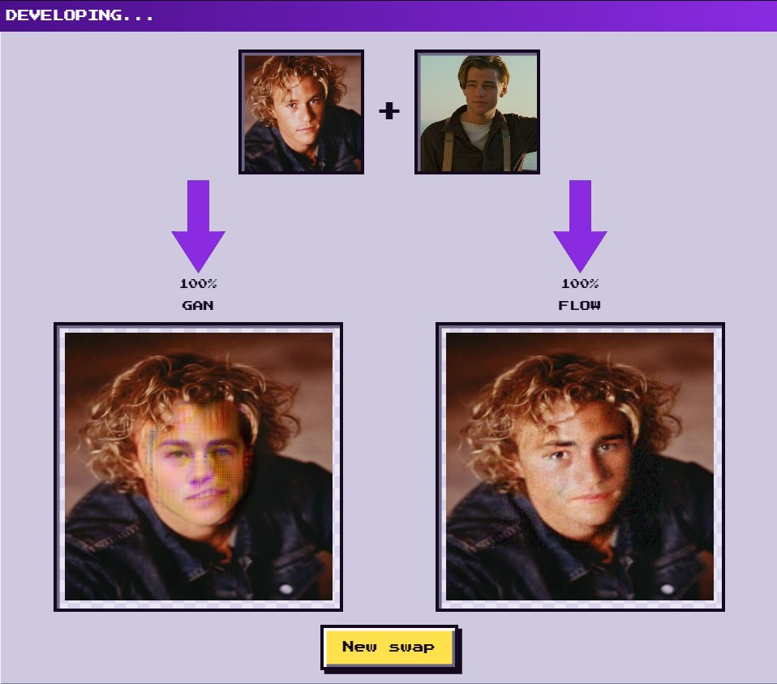

#  Face Exchange Booth: Conditional Flow Matching vs. GANs

Welcome to the **Face Exchange Booth**, an experimental deepfake and face-swapping project designed to demonstrate a core thesis: **Conditional Rectified Flow Matching is a fundamentally more stable and effective approach than Generative Adversarial Networks (GANs) for face swapping.**


*Above: A visual comparison demonstrating the transition from Heath Ledger to Leonardo DiCaprio. Notice how Conditional Flow Matching preserves spatial integrity and skin texture without the characteristic adversarial artifacts often introduced by GANs.*

##  The Experiment: Why Conditional Flow Matching Wins

Historically, GANs have been the go-to architecture for face generation and swapping. However, they suffer from well-documented issues: mode collapse, training instability, and a tendency to introduce high-frequency visual artifacts. 

In this project, we replace the traditional adversarial game (Generator vs. Discriminator) with **Conditional Rectified Flow Matching**. 
* **GAN Approach:** Relies on adversarial loss and AdaIN modules to force a generator to fool a discriminator. This often results in a delicate balancing act that is hard to train and prone to errors.
* **Flow Matching Approach:** Eliminates the discriminator entirely. It formulates generation as a deterministic vector-field regression problem. By training a model to predict straight-line interpolation paths between a source image distribution and a target identity, it achieves smoother blending, better identity preservation, and absolute training stability.

---

##  Installation Guide

To run the Face Exchange Booth locally, follow these steps:

1. **Clone or Download the Repository:**
   Ensure you have the complete project structure, including the `deepfake_GAN`, `deepfake_conditional_flow`, `images`, and `static` directories.

2. **Set up a Virtual Environment:**
   It is highly recommended to use a virtual environment to manage dependencies.
   ```bash
   python -m venv venv
   # On Windows:
   .\venv\Scripts\activate
   # On macOS/Linux:
   source venv/bin/activate
   ```

3. **Install Dependencies:**
   Install the required Python packages using the provided `requirements.txt`.
   ```bash
   pip install -r requirements.txt
   ```

4. **Verify Checkpoints:**
   Ensure the following model weights are present in their respective directories (as referenced in `app.py`):
   * `deepfake_GAN\ckpt_final_step205615_GAN_final.zip`
   * `deepfake_conditional_flow\best.zip`
   * `deepfake_conditional_flow\79999_iter.pth` (BiSeNet checkpoint)

5. **Run the Application:**
   Start the Flask server.
   ```bash
   python app.py
   ```
   Open your browser and navigate to `http://127.0.0.1:5000`.

---

##  Training Details

The models in this repository were trained extensively using distinct methodologies. Below is an elaborate breakdown of how both the GAN and Conditional Flow architectures were developed.

### 1. GAN Training
**Notebook:** [Source and Target Seg Model GAN Training](https://www.kaggle.com/code/nilanjansaha123/source-and-target-seg-model-gan-training)

The GAN pipeline was trained using a standard adversarial setup paired with identity preservation techniques. 
* **Architecture:** The generator utilizes AdaIN (Adaptive Instance Normalization) to inject target identity features into the source face latent space. 
* **Losses:** It relies on a combination of adversarial loss (to ensure realistic textures), VGGFace2 identity loss (to maintain the target person's likeness), and reconstruction loss. 
* **Challenges:** As evidenced by the multiple "resuming training" notebooks in the repository, the GAN required careful hyperparameter tuning and multiple staged runs to combat mode collapse and stabilize the discriminator gradients. Masking via BiSeNet was heavily utilized to ensure only the inner facial region was modified, leaving the background intact.

### 2. Conditional Flow Matching Training
**Notebook:** [Conditional Rectified Flow Matching Paired Face](https://www.kaggle.com/code/nilanjansaha123hello/conditional-rectified-flow-matching-paired-face)

The Flow Matching model represents the modern evolution of this project.
* **Architecture:** The adversarial network is entirely replaced by a `FlowMatchingUNet`. This U-Net uses `ConditionalResBlock`s and an `IdentityCrossAttention` module to seamlessly inject the target's 512-dimensional VGGFace2 identity embedding (L2-normalized) into the generation process.
* **Objective:** The model is trained using an MSE flow-matching objective. It learns the deterministic vector field pointing from the source image crop directly to the target identity. 
* **Optimization & Inference:** Pre-caching BiSeNet face bounding boxes and embeddings drastically sped up training. During inference, instead of a single unstable forward pass, the model uses a deterministic 4-step Heun ODE solver to iteratively "flow" the source face into the target face. The resulting crop is then feather-blended back into the original image using a Gaussian blur mask, yielding incredibly photorealistic results.

---

##  The App: 90s Face Exchange Booth

The application (`app.py` and `static/index.html`) isn't just a technical demo; it's a nostalgic trip back to the 90s. 

* **The Aesthetic:** Designed with a distinct 90s retro-computing vibe, the UI features `VT323` and `Press Start 2P` pixel fonts, harsh neon violet/yellow accents, and a wiggling "image wall." 
* **The Craze:** The image wall capitalizes on 90s Hollywood nostalgia, featuring popular stars like Leonardo DiCaprio, Winona Ryder, Matt Damon, and Heath Ledger. Users can play casting director, swapping the iconic faces of these actors in a virtual "photo booth."
* **Under the Hood:** The backend is powered by Flask. Because loading two heavy deep learning models can cause GPU Out-Of-Memory (OOM) errors, `app.py` cleverly utilizes `threading.Lock()` to ensure that inference jobs queue up safely. The frontend uses asynchronous fetching and a custom fluid-fill progress arrow to keep the user engaged while the models run side-by-side for comparison.